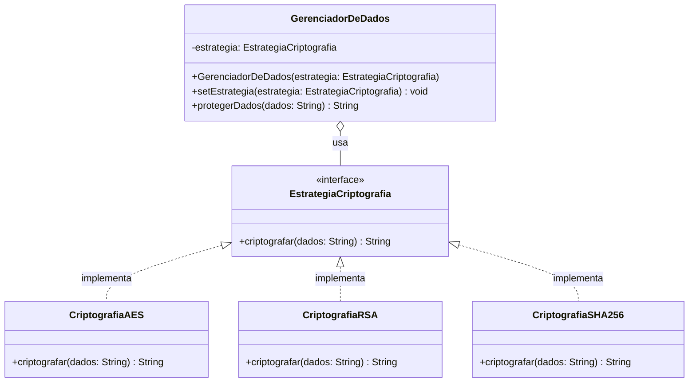

# Padrão Strategy - Estratégias de Criptografia de Dados

Implementação do padrão de projeto **Strategy** (Comportamental) em Java. O projeto demonstra como definir uma família de algoritmos, encapsular cada um deles e torná-los intercambiáveis em tempo de execução, permitindo que o algoritmo varie independentemente dos clientes que o utilizam.

## Descrição

### O Problema
Em um sistema de segurança da informação, diferentes tipos de dados exigem diferentes algoritmos de proteção. Dados em repouso podem usar **AES** (rápido e simétrico), troca de chaves pode exigir **RSA** (assimétrico), e validação de integridade pode usar **SHA-256** (hashing). 

Implementar isso com condicionais (`if (tipo == "AES") ... else if (tipo == "RSA")`) viola o **Princípio Aberto/Fechado (OCP)**. Toda vez que um novo algoritmo (ex: ChaCha20) for adicionado, a classe principal precisaria ser modificada, aumentando o risco de regressão.

### A Solução
O padrão Strategy extrai cada algoritmo para uma classe separada que implementa uma interface comum (`EstrategiaCriptografia`). O contexto (`GerenciadorDeDados`) não sabe *como* a criptografia é feita, apenas *que* ela pode ser feita, delegando a execução para a estratégia injetada.

## Estrutura do Projeto
```bash
src/
├── main/
│   └── padroescomportamentais/strategy/
│       ├── EstrategiaCriptografia.java      ⁦(Interface Strategy)⁩
│       ├── CriptografiaAES.java             ⁦(ConcreteStrategy A)⁩
│       ├── CriptografiaRSA.java             ⁦(ConcreteStrategy B)⁩
│       ├── CriptografiaSHA256.java          ⁦(ConcreteStrategy C)⁩
│       └── GerenciadorDeDados.java          ⁦(Context)⁩
│
└── test/
└── padroescomportamentais/strategy/
└── GerenciadorDeDadosTest.java      ⁦(Casos de teste
```

## Diagrama de Classes

O diagrama abaixo ilustra a composição entre o Contexto e a Interface Strategy.



## Análise Crítica: Vantagens e Pontos Cegos

É fundamental entender as limitações do padrão para aplicá-lo corretamente em cenários reais.

### Vantagens (Fatos)
*   **Princípio Aberto/Fechado (OCP):** Novos algoritmos podem ser adicionados criando novas classes, sem tocar no `GerenciadorDeDados`.
*   **Princípio da Responsabilidade Única (SRP):** A lógica complexa de cada algoritmo fica isolada em sua própria classe.
*   **Elimina Condicionais:** Substitui blocos `switch/case` complexos por polimorfismo.

### Pontos Cegos e Contrapontos (Onde o padrão exige cuidado)
1.  **Complexidade Deslocada para o Cliente:**
    *   *Fato:* O padrão remove o `if/else` do Contexto, mas **alguém** precisa decidir qual estratégia usar.
    *   *Contraponto:* Essa responsabilidade é empurrada para o cliente (quem instancia o Contexto). Se a lógica de escolha for complexa, o cliente ficará poluído. *Solução comum:* Combinar Strategy com **Factory Method** ou **Injeção de Dependência** (DI) para encapsular a escolha.
2.  **Acoplamento na Interface da Strategy:**
    *   *Fato:* Todas as estratégias devem compartilhar a mesma assinatura de método.
    *   *Contraponto:* Se o algoritmo `RSA` exigir um parâmetro extra (ex: `chavePublica`) que o `AES` não usa, a interface `EstrategiaCriptografia` será forçada a aceitar parâmetros genéricos (como `Map<String, Object>`), o que quebra a tipagem forte e a segurança do código.
3.  **Overhead de Objetos:**
    *   *Opinião/Fato:* Criar uma nova instância de Strategy para cada operação pode gerar pressão no Garbage Collector.
    *   *Contraponto:* Se as estratégias não mantêm estado (são *stateless*), elas devem ser implementadas como **Singletons** ou instanciadas apenas uma vez e reutilizadas via Injeção de Dependência.

## Diferença Crucial: Strategy vs. State

Esta é a confusão mais comum em provas e revisões de código, pois o diagrama de classes é estruturalmente idêntico.

| Característica | Padrão Strategy | Padrão State |
| :--- | :--- | :--- |
| **Intenção** | Trocar **algoritmos** ou comportamentos intercambiáveis. | Mudar o **comportamento** baseado no ciclo de vida/estado interno. |
| **Quem escolhe?** | O **Cliente** (externo) injeta a estratégia desejada. | O **Contexto** ou a própria classe de Estado decide a transição. |
| **Conhecimento** | As estratégias **não se conhecem**. | Os estados frequentemente **conhecem** outros estados (transições). |
| **Exemplo** | Escolher entre Criptografia AES ou RSA. | Um incidente mudar de "Aberto" para "Em Análise". |

## Testes

O projeto contém testes unitários (JUnit 5) que validam:
*   O Contexto delega corretamente a execução para a estratégia injetada.
*   A estratégia pode ser trocada em tempo de execução (`setEstrategia`) e o comportamento do Contexto muda imediatamente.
*   O Contexto não possui dependência direta com as classes concretas (`AES`, `RSA`).

## Tecnologias Utilizadas

| Tecnologia | Versão | Finalidade no Projeto |
| :--- | :--- | :--- |
| **Java** | 21 | Linguagem de programação principal |
| **Maven** | 3.9+ | Gerenciamento de dependências e automação de build |
| **JUnit 5** | 5.9.x | Framework para execução dos testes unitários |
| **Draw.io** | Web | Criação e exportação dos diagramas UML |
